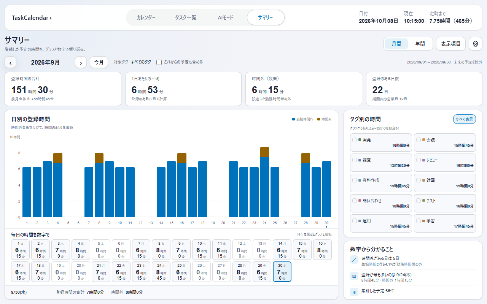
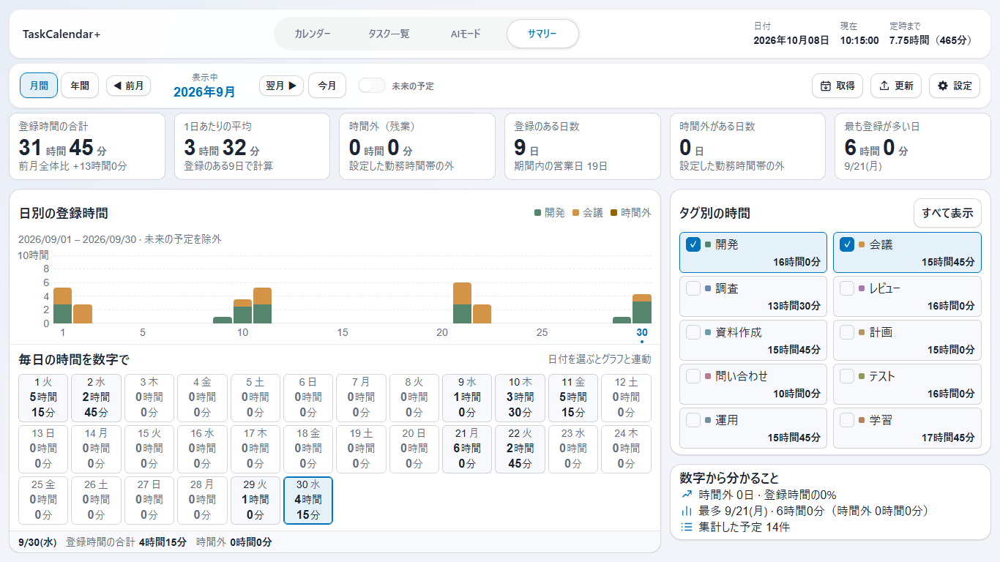
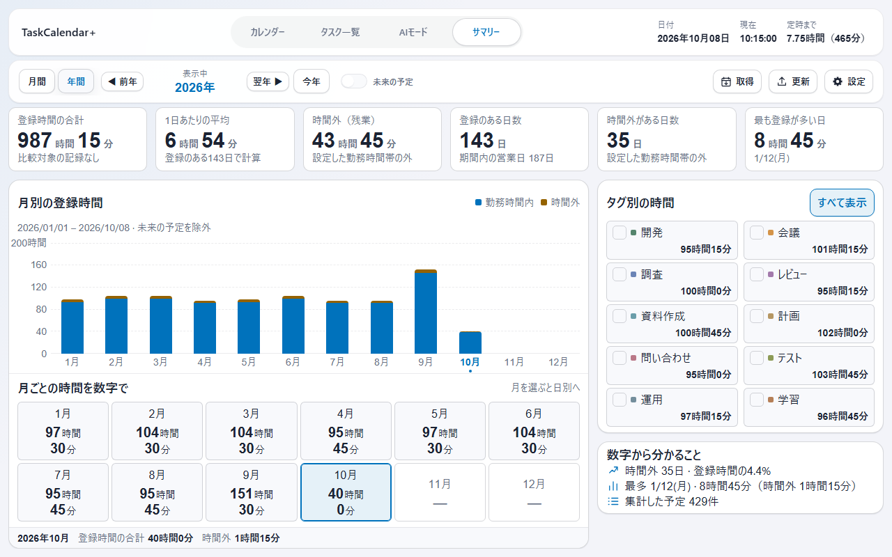
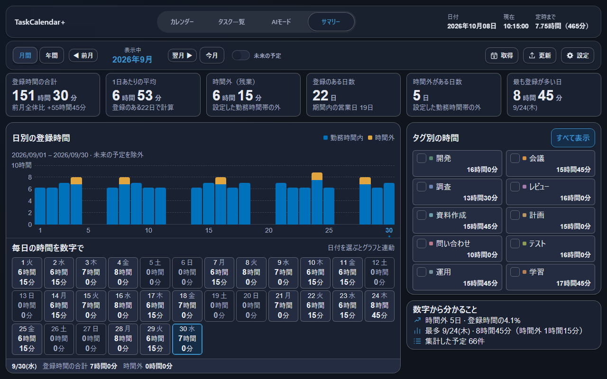
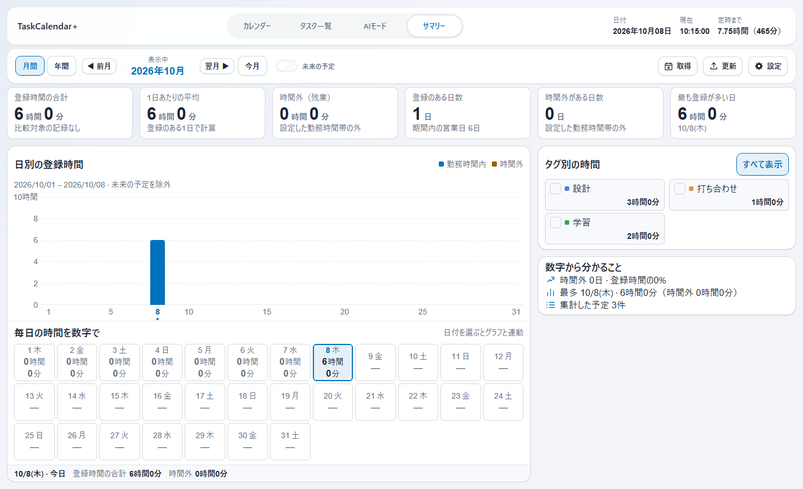
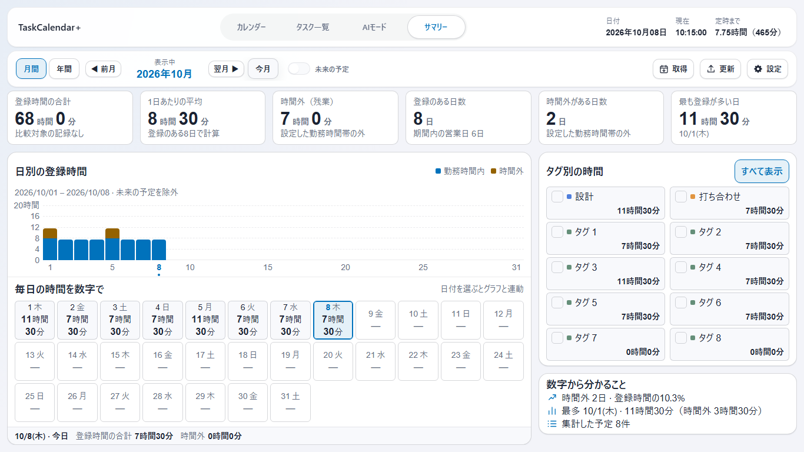

# サマリーの読みやすさと操作バー（未リリース）

対象はサマリー画面。上部の画面切替タブと「取得・更新・設定」の操作バーは既存の共通スタイルをそのまま使用する。拡大するのはサマリー本文の文字・部品。左にグラフと数字、右にタグと要約という元の配置を保った。他の3画面と共通設定ダイアログの本文サイズは変更しない。

## 変更した内容

| 項目 | 変更前 | 今回の変更 |
|---|---|---|
| 主な文字・操作 | タグ名11pxなど | サマリー本文内の文字・操作16px、主要数値30px |
| 表示項目 | 初期4項目、選択上限4 | 6項目を常時表示。「表示項目」ボタンとダイアログを削除 |
| 補足・日付・単位 | 8〜11pxが多数 | 14px以上 |
| 共通タブ・操作バー | サマリー固有の歯車だけ | 取得・更新・設定を復元し、寸法・文字サイズを既存3画面と統一 |
| 期間移動 | 矢印だけ | 既存カレンダーのボタン部品と翻訳で「◀ 前月／翌月 ▶」「◀ 前年／翌年 ▶」を表示 |
| 表示中の期間 | ボタン間の13pxの文字 | 「表示中」の説明と18pxの年月・年をまとめて表示。共通ツールバーの高さは維持 |
| 日別の数字 | 16列でグラフ下へ配置 | グラフ下を維持し、12列×3行。日付・曜日と時間・分を同時表示 |
| 年間の数字 | 12個を横並び | グラフ下に6列×2行。月を選ぶと日別へ移動 |
| タグ | 右の領域 | 右側の2列を維持。名前と時間を上下に表示 |
| タグの見出し | 上余白2px | 上余白12pxを確保し、左のグラフ見出しとも整列 |
| 上段と下段の縦境界 | 右列400px固定で上段カードと不一致 | 同じ6列を共有し、グラフは4列、タグ・要約は2列。上段4／5枚目との境界を揃える |
| 要約 | 小さい文章を複数行 | 同じ日数・割合・最長日・件数を簡潔な文で表示 |

すべての棒と日付の数字は残している。グラフの横軸は間隔を空けて日付を表示し、選択した日も表示する。タグの時間割合は、時間表示のツールチップで確認できる。

取得・更新・設定は既存処理を再利用する。サイドバーの追加や取り込み期間の自動変更は行わない。日別・月別集計、タグの複数選択、時間・分の精度、再試行の動作を維持する。

6項目は「登録時間の合計・1日あたりの平均・時間外・登録のある日数・時間外がある日数・最も登録が多い日」。以前の項目選択にかかわらず6項目を表示し、保存済み設定自体は書き換えない。既存の平均計算方式はそのまま使う。長い補足文は省略表示と全文ツールチップで扱い、数値や時間・分の単位は省略しない。

## 全体の統一監査

カレンダー・タスク一覧・AI・サマリー、タスク編集・一括変更・削除確認・アップデート、設定全11ページを隔離Chromiumで確認した。設定11ページは通常幅で目視し、狭幅と暗色は代表状態を選んだ。全状態の網羅を意味しない。「表示項目」ダイアログは今回削除した。

| 修正箇所 | 修正内容 |
|---|---|
| 狭幅の画面切替 | 3列のまま残った指定を4列へ修正し、サマリーだけ次の行へ落ちる問題を解消 |
| 未来予定のON/OFF | カレンダー・AIと同じスイッチ部品とキーボード操作を使用 |
| 表示項目 | 選択用ボタン・ダイアログ・イベント処理・不要なCSS／翻訳を削除 |
| 月間・年間の選択 | 文字色に加え、既存と同じアクセントの背景と枠で表示 |
| 月間・年間の移動 | 前月・翌月／前年・翌年の説明と矢印を既存ボタンに統一。キー操作と年跨ぎ・境界を確認 |
| タグ見出しの余白 | 「すべて表示」が枠上端へ詰まらないよう上余白を確保 |
| 設定スイッチ | 更新確認・Outlook自動同期のラベルを左、スイッチを右へ統一 |
| 設定のタグ入力 | 狭幅で下限・上限が28pxまで縮む問題を修正。折り返して72pxを確保 |

共通タブ・操作バー、設定の背景・目次、右クリックメニュー、危険操作／確定／取消の色の規則は維持した。グラフや数値の配置は変更していない。

## 同じ条件の変更前後

実際のrendererを隔離Chromiumで動かし、同じ架空の予定430件・タグ10個・固定日時で撮影した。画像は1280×800、標準CSS倍率。実Windowsアプリや実ユーザーデータを撮影したものではない。

| 変更前（v4.0.0） | 変更後（開発中） |
|---|---|
|  |  |

| 複数タグ・1366×768 | 年間 |
|---|---|
|  |  |



上段4枚目の右端とグラフの右端、5枚目の左端とタグ・要約の左端を揃えた。両段の間隔は12px。提示画像に近い1422×866のCSS表示領域では、それぞれ940px／952pxで一致する。次は3タグの検証用データで撮影した実renderer。



## 今月へ戻すときのスクロール修正

再現条件では、今月の最長日の説明が2行になり、右下の要約が104pxから126pxへ増えた。タグ欄の高さが固定だったため、右列全体が割当高さを超えていた。

タグ行は通常56pxを保ち、必要な場合だけ52pxまで内側の余白を縮める。文字16px／14pxと見出しの上余白12pxは維持し、要約の内容を隠さず収める。月・年の移動、タグの複数選択／解除でも確認した。

| CSSビューポート | 修正前・今月の内側はみ出し | 修正後 |
|---|---|---|
| 1366×768 | 3px（内容606px／領域603px） | 0px（603px／603px） |
| 1264×761 | 10px（内容606px／領域596px） | 0px（596px／596px） |
| 1280×800 | 0px | 0px |

低い画面では従来どおり縦スクロールで操作でき、内容を切り捨てない。1280×720はこの対象。確認した範囲を超えるウィンドウ寸法・OS倍率での無スクロールは保証していない。

次の画像は別の再現用31件・10タグで、「今月」を押した後の実rendererを撮影したもの。固定日時はヘッダーと集計の両方で2026年10月8日。



## 確認条件と限界

今回の縦境界修正後は、関連する5スイート（整列・今月復帰・読みやすさ・サマリー操作・共通UI）が合格。整列は3／10タグ×3画面幅×月間／年間を比較し、修正前のずれを検出してから修正後の一致を確認した。04a200f時点のNode49スイート・JavaScript58ファイルの構文検査は過去の結果で、今回の全体再実行を意味しない。集計計算・DBスキーマ・ネイティブ処理は変更していない。画像と検証範囲は[検証記録](summary-readable-evidence.json)に保存した。

- 1280×800・1366×768で、31日・10タグ・指標6個とグラフを、通常時はスクロールなしで表示する。
- 文字サイズの下限、実際の文字領域の欠け、操作部の重なり、パネル間の重なりを計測する。23時間59分の日別表示と選択連動、年間8,753時間55分の桁数でも6カード内に収まることを確認した。
- 9言語の月間・年間と、長い翻訳がある狭い条件を確認する。名前が長いタグは文字を縮めず、省略表示と完全な名前のツールチップ・読み上げ名で扱う。
- 小さい表示領域、再取得エラー中、クイックリンクで上部が高くなる場合は、縦スクロールで操作を保つ。文字を縮めて一画面へ押し込まない。1024×640、1000×800、800×600でパネルの非重複と日付・タグへの操作到達を確認する。
- 取得・更新・設定の画面が開くことを確認。1366・1280・1000px幅で4画面を切り替え、サマリー表示中もヘッダー・タブ・操作バー・共通ボタンの寸法・文字サイズ・内側余白が一致することを確認した。専用CSSが残る修正前では失敗し、削除後に成功した。
- 元の配置を保つ回帰テストで、左のグラフの下に数字があり、右のタグの下に要約があることを検査する。内側の数字領域と親パネルの包含を許可し、別パネル同士の重なりは引き続き検出する。
- 今月スクロール修正後、別担当が差分・テスト内容・「今月」後の最終画像を確認し、重大な指摘はなかった。実アプリ検証は行っていない。

前段の共通バー修正時には開発版EXEの起動・応答を確認した。今回の6項目表示と全体UI修正は隔離Chromiumで検証しており、起動中の実ウィンドウへの反映・操作、実機倍率、実Outlook・実AI・インストール更新は未確認。バージョン変更・mainへのマージ・リリースは行っていない。

検証用の主要コマンド:

```powershell
node scripts/test-summary-readable.mjs
node scripts/test-summary-current-period.mjs
node scripts/test-summary-ui.mjs
node scripts/test-summary-alignment.mjs
node scripts/test-summary-preferences.mjs
node scripts/test-ui-consistency.mjs
node scripts/test-settings-control-consistency.mjs
node scripts/capture-summary-preview.mjs out/summary-preview
node scripts/refactor-20261008-checks.mjs . out/summary-checks node
```
