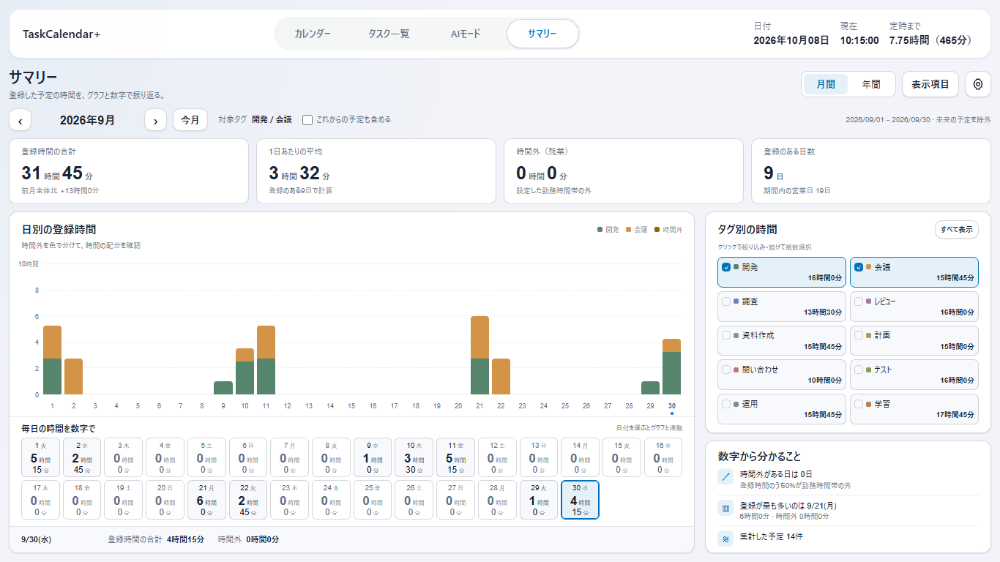
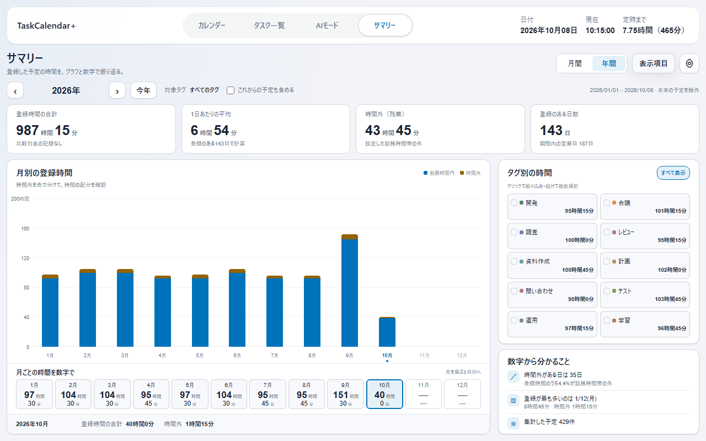
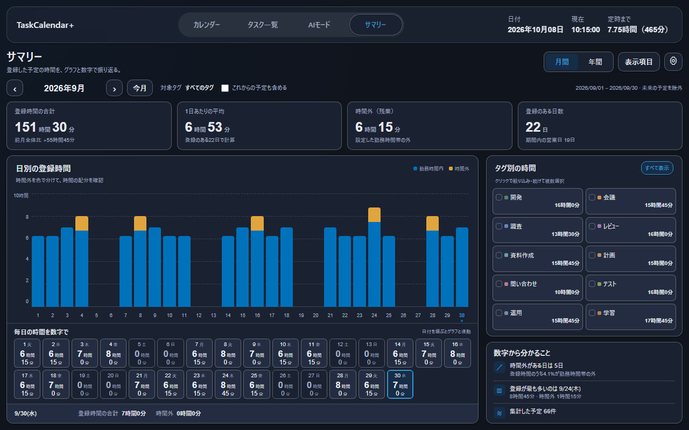
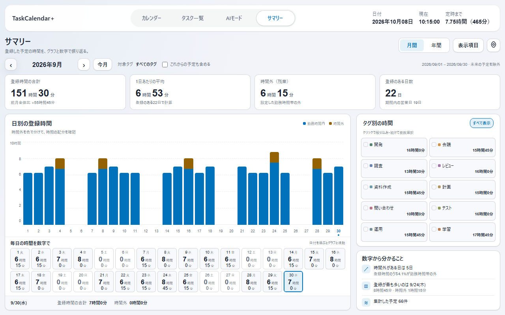

# サマリー画面の実装報告（v4.0.0）

承認済みの[HTMLモック](../mockups/summary-v1.html)を、アプリの予定・タグ・設定から計算する画面として実装した。対象は [Issue #31](https://github.com/t-ueda21/TaskCalendar-Plus/issues/31)、配布対象はv4.0.0。この報告と証跡JSONは公開前の実装・検証を記録しており、配布物と公開状況は[リリースページ](https://github.com/t-ueda21/TaskCalendar-Plus/releases/tag/v4.0.0)で確認できる。

## 反映した内容

| 要求 | 実装 |
|---|---|
| AIモードの次にサマリー | 共通ナビゲーションの4番目に追加。月間・年間を選択 |
| グラフと数字を同時表示 | 上に棒グラフ、下に日ごと／月ごとの時間・分。日付を選ぶと双方を強調 |
| タグの複数選択 | 全タグ表示から1個を選ぶと単独表示。続けて複数選択でき、全体の集計とグラフも連動 |
| 10タグでも収まる配置 | 2列×5行。11タグ以上はページ切り替え。ページを移っても選択を保持 |
| スクロールなし | 1280×800・1366×768の表示領域、標準倍率で確認。小さい画面や拡大時は操作を隠さずスクロール |
| 右下の要約 | 時間外がある日数・割合、登録が最も長い日、予定件数をデータから算出。AIへ送信しない |
| 表示項目 | 合計、平均、時間外、登録日数、時間外の日数、最長日から1〜4項目。平均の分母も選べる |
| 不要な要素を削除 | 「これまで」、日ごとの詳細表、集計の見方ボタンを追加しない |

## 計算と保存

- タグ付きで時間がある予定を対象に、設定した休憩を除外する。終日・タグなし・削除済みタグ・不正な時間は含めない。
- 日をまたぐ予定は日付境界で分割し、予定件数は同じIDを重複カウントしない。
- 同じ時刻の予定は重複加算しない。複数タグを選んだ場合も合計は時間帯の和集合。タグごとの値にはタグ間の重なりがあるため、タグ別の数字の合計と全体の合計は一致しない場合がある。
- 選択タグ別のグラフは、個別タグの時間・タグ間の重複・時間外を分け、棒の高さを全体の合計と一致させる。
- 時間外は設定した勤務時間帯の外。営業日数は勤務曜日・日本の祝日・会社休日から計算する。
- 初期状態は日本時間の今日まで。未来の登録予定を含めるかを切り替えられる。現在月の前月比較は、経過した営業日数を揃える。
- 表示項目と平均の分母を既存の設定に保存する。予定の複製やデータベースの移行は行わない。サマリーから予定を変更しない。
- 予定・タグ・勤務設定の変更に追従する。外部で選択中のタグが削除されても、自動的に全タグへ対象を広げない。
- 再取得失敗時は前回表示を残し、再試行を表示する。設定保存失敗時は選択中の内容を保持し、再度保存できる。

## 実装画面

実際のrenderer／Storeを隔離したChromiumで動かした画像。予定430件・タグ10個は架空、日時は2026年10月8日10時15分に固定し、API・ネイティブ・天気の応答は検証用に置き換えている。インストール版や実Outlook・実AIとの接続結果ではない。

| 月間・10タグ | 2タグを選択 |
|---|---|
|  |  |

| 年間 | ダークテーマ |
|---|---|
|  |  |

## 整列の再確認と修正（2026-10-23）

初回の検証は画面内への収まりと操作の確認に偏り、細部の整列を十分に確認できていなかった。指摘後、部品の位置関係を計測して次を修正した。

| 箇所 | 修正前 | 修正後 |
|---|---|---|
| グラフの目盛りと横線 | 文字枠の中心と線の中心が最大9.25pxずれていた | 同じ描画範囲に配置し、ずれは0.5px以内 |
| 右上の操作部 | 高さが37.5px・約35.55px・34pxとばらばら | 36pxに統一し、上端と下端を揃えた |
| パネル内の左端 | 見出し・日別の数字・下部の詳細で最大3pxのずれ | 同じ16pxの内側余白を共有 |
| 表示項目が1〜3個のとき | 4列固定で右側に空白が残る | 選んだ項目数で行全体を等分 |

1280×800の同じ架空データでの比較。グラフと数字の同時表示・複数タグ・10タグの2列配置は維持している。

| 修正前 | 修正後 |
|---|---|
|  |  |

位置関係を確認する `test-summary-alignment.mjs` を追加した。月間／年間、1280×800／1366×768、ドイツ語・ダークテーマ、表示項目1〜4個を確認する。前回と同様、インストール版の操作確認は行っていない。

## 検証

ローカルの隔離環境で次を確認した。詳細な実行結果・ソース識別値・画像識別値は [evidence.json](summary-screen-evidence.json) に保存する。

| チェック | 結果 |
|---|---|
| Node | 46スイート合格 |
| Rust | 231合格、ライブ接続用9件は未実行 |
| JavaScript構文 | 58ファイル合格 |
| Clippy | 警告をエラーとして扱い合格 |

整列修正後の全49コマンドが成功。実行中にソース・テストが変化していないことも確認した。

- 集計：空データ、休憩、重複、時間外、深夜・月・年またぎ、閏日、祝日・会社休日、未来除外、比較期間、入力を変更しないこと。
- 画面：グラフと数字の同時表示、対象サイズでの収まり、単独・複数タグ、年間から月間への移動、10タグ超のページ切り替え、キーボード操作、長いタグ名とHTML文字列。
- 状態：予定の追加・編集・削除、設定変更、選択タグの削除、保存・再取得失敗と再試行、設定の再読み込み、空の表示。
- 表示：9言語、明暗テーマ、翻訳された読み上げラベル。年間の時間軸ラベルの折り返しも修正して再確認した。
- 初回実装では独立コードレビューを1回実施。翻訳キーと読み上げラベルの指摘を修正し、回帰検証を行った。今回の整列修正は実装担当が画像と位置計測で確認した。

実Windowsアプリの起動・インストール、実ユーザーデータ、実Outlook、実AIは未検証。ライブ接続を必要とするRustテスト9件は意図的に除外した。GitHub CIの状態はPRで別に確認する。

再現する場合は、既存の隔離Chromium用依存関係を用意して次を実行する。出力先は存在しないフォルダーを指定する。

```powershell
node scripts/test-summary-model.mjs
node scripts/test-summary-preferences.mjs
node scripts/test-summary-ui.mjs
node scripts/test-summary-alignment.mjs
node scripts/capture-summary-preview.mjs out/summary-preview
node scripts/refactor-20261008-checks.mjs . out/summary-checks all
```
