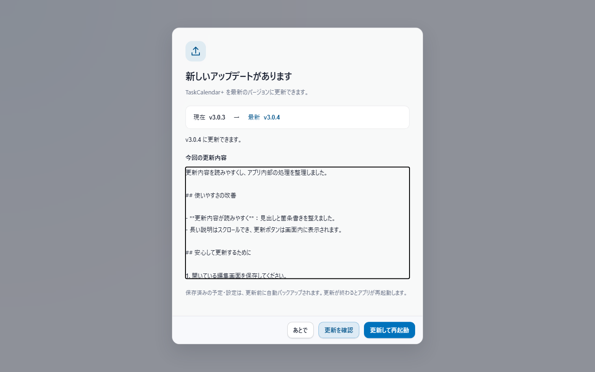
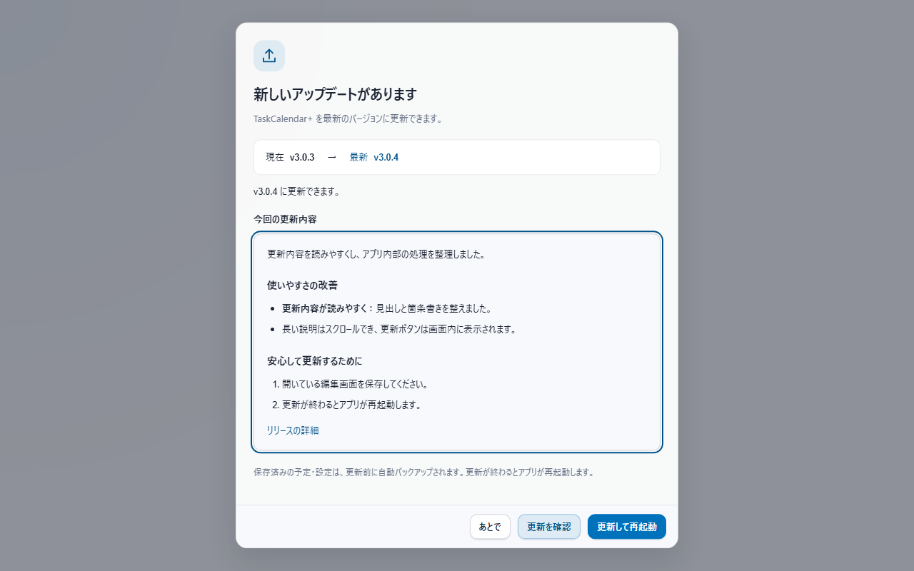

# v3.0.4 更新画面とリファクタリングの実施報告

対象: [Issue #29](https://github.com/t-ueda21/TaskCalendar-Plus/issues/29)、[Issue #30](https://github.com/t-ueda21/TaskCalendar-Plus/issues/30)。最新main `559a190` を取得してからIssue登録・実装した。

## 更新画面

Markdownの記号をそのまま表示していた箇所を、見出し・箇条書き・強調・リンク・表の整った表示に変更した。既存のHTMLエスケープ処理を利用し、外部のHTMLを実行しない。空の内容は表示枠を出さず、長文をスクロールしても更新操作へアクセスできる配置にした。

| 変更前 | 変更後 |
|---|---|
|  |  |

画像は実際のHTML・CSS・JavaScriptを隔離したChromiumで表示したもの。1280×800、ライト、日本語。バージョン表示・説明文・ネイティブ更新処理はテスト用の応答で、実インストールの証拠ではない。別途ダークと390×700のドイツ語UIも確認した。

## リファクタリング

表示改善を終えた状態を基準にし、`refactor-with-baseline` のA（基準設計）、B（実装）、C（独立検証）を別のエージェントへ割り当てた。役割はそれぞれ `/root/refactor_304_baseline`、`/root/refactor_304_impl`、`/root/refactor_304_verify`。

変更対象は `app-updater.js` と `app-update-controller.js` の2ファイル。固定DOM参照を初期収集へ移し、更新入口ボタンの描画を関数へ分離した。状態フラグを共通化し、直後に上書きされる代入と未使用importを除いた。コントローラーの状態遷移、Outlook、保存形式は変更していない。

| 測定対象 | 変更前 | 変更後 | 結果 |
|---|---:|---:|---|
| 対象2ファイルの容量 | 8,913 bytes | 9,249 bytes | 336 bytes増加 |
| 対象2ファイルの物理行 | 180 | 193 | 13行増加 |
| アプリ本体の容量 | 1,928,431 bytes | 1,928,767 bytes | 336 bytes増加 |
| 短文の更新画面描画100回・中央値 | 6.0ms | 5.4ms | 小差、有意な高速化は主張しない |
| 長文の更新画面描画25回・中央値 | 23.5ms | 22.5ms | 小差、有意な高速化は主張しない |

行数はコメントを含む物理行。テスト、文書、画像、依存ライブラリ、生成物を本体量から除外した。今回は容量削減ではなく、描画の責務と参照先の整理が成果である。性能は同じPC・ブラウザー・合成データで2回のウォームアップ後に7回測定し、18指標とも事前に定めた許容範囲内だった。実インストール速度やネイティブプロセスのメモリは測定していない。

## 検証と限界

- Node 42スイート、Rust 231件、JavaScript構文53ファイル、Clippyが前後とも成功。
- 画面操作38ケース、更新ライフサイクル8ケースも前後とも成功。ID・対象行・未変更行・集計・取消・競合を検査した。
- テスト、期待値、基準画像等1,037ファイルの固定ハッシュを独立担当が照合した。
- 元画像55枚中51枚はPNG全体が一致。4枚は54〜537画素、色成分差最大1〜8の差が残った。3枚は同版の再撮影でも差が再現した。残るcurrent画面の28要素は文言・位置・採取CSS・フォーカスが一致した。完全な画素一致とは扱っていない。
- 実Outlookを必要とする9件、Tauri/WebView2の起動、実インストーラーの適用と実アプリ内更新は未検証。
- 旧画面試験のメモ期待値をv3.0.3のlocalMemo仕様へ合わせ、Rustの外部テストを誤って本体量から除外していた計測器も基準作成時に修正した。同じ修正済み契約で前後を測定し、初回結果も保存した。

詳細ログ・前後ソース・原画像・生標本はローカルの `out/refactor-20261022/` に保存。最終比較は `comparison-final.md` / `comparison-final.json`、再実行手順は `reproduce.md`。公開するCI・配布物の検証はこのローカル比較とは別に行う。

試験的なサマリー画面（Issue #31）はv3.0.4に含めず、公開後にHTMLモックを提示する。
